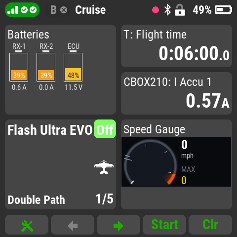
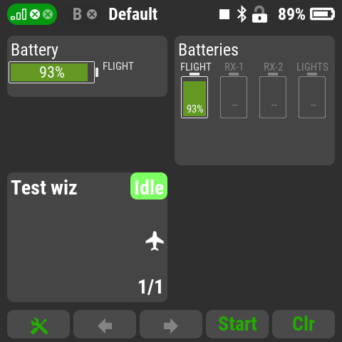
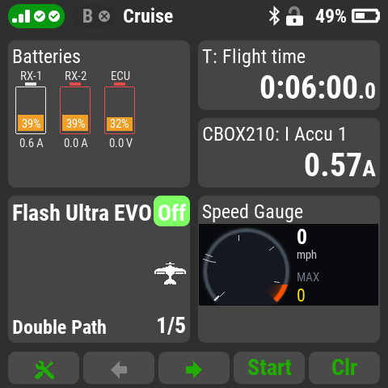
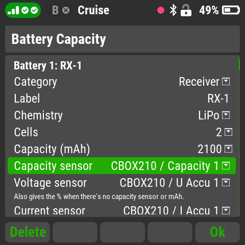
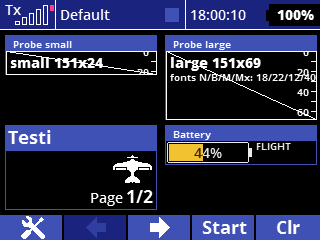

# Battery Capacity

Up to four battery packs per model (receiver, turbine ECU, landing gear,
brakes, lights, aux or flight packs) as battery gauges on the main screen,
with spoken callouts that name the pack: "receiver two, 30 percent". For the
JETI **DC/DS-24 II** and the **first-version DC/DS-24**.

## What it does

- **Two windows:** one battery on its side (single size) or up to four
  upright batteries (double size). Each fills in green, yellow, orange or red
  by % remaining, with the current (or, without a current sensor, the
  voltage) under it.

  
- **Any capacity sensor:** mAh used (MUI, Central Box), % remaining, or the
  voltage alone, including the receivers' own voltages. An mAh pack starts at
  the % its resting voltage shows and counts down from there, so a
  part-charged pack is right from the start, and a Central Box's count from
  earlier flights doesn't matter.
- **Callouts:** up to four capacity levels per pack (the lowest repeats), a
  low-voltage alarm per cell or per pack with a flashing red outline, an
  optional current alarm, session max current and an optional "pack not
  full" check when you plug a pack in.

  
- **Pack swap or brown-out:** after telemetry drops out and comes back, a
  fresh pack resets that pack's callouts; a brief dropout keeps them.
- **Smart defaults** from the pack's category and chemistry (LiPo, LiHV,
  Li-ion, LiFe, NiMH/NiCd); everything can be changed. "Show all settings"
  shows the colour bands, voltages, delays and repeat limits.

**Advisory only.** The app never controls the model, and it doesn't replace
the transmitter's own receiver-voltage alarm.

## Setting up

1. Add **Battery Capacity** in *Applications → User Applications*.
2. In its settings choose **Add battery**, then the category, chemistry,
   cells, capacity (mAh) and the sensors:
   - **Capacity sensor**: mAh, Ah, % or V.
   - **Voltage sensor**: every pack needs one. Until it's set, the battery's
     screen flashes a reminder and the app's list shows "SETUP!". On a
     Central Box, pick *U Accu 1/2*: the receiver measures the box's
     regulated output, not the pack.
   - **Current sensor** (optional): the window then shows current under the
     battery instead of voltage.
3. Put **Batteries** (double size) or **Battery** (single size) on a page in
   *Timers/Sensors → Displayed telemetry*. Both titles can be renamed.

Settings are saved per model.

*The single-size window on a first-version DS-24.*

## Credits and licenses

- Voice: **Piper** text-to-speech with the voice model **"Amy"** by
  Mycroft / Rhasspy. The sound files (in `/Apps/AG-BatCp/voice/`) are
  licensed **CC BY-SA 4.0**.
- Battery Capacity itself: MIT license, Copyright (c) 2026 Aaron George.

Source, full credits and license texts:
[github.com/Flazzarious/jeti-lua-apps](https://github.com/Flazzarious/jeti-lua-apps)
