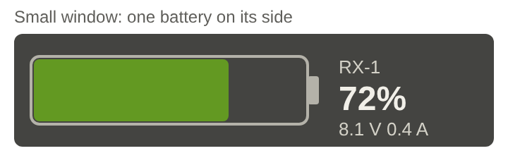
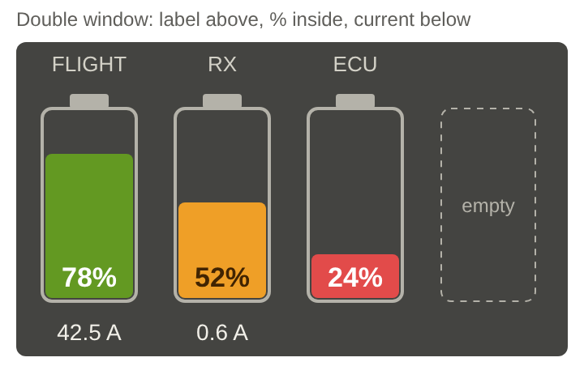

# Feature Specification: Battery Capacity

**Feature Branch**: `feature/005-battery-capacity`

**Created**: 2026-10-25

**Status**: Draft

**Input**: User description: "Battery Capacity, an in-flight telemetry
display app that shows at a glance how much capacity is left in up to four
batteries, with optional current readout and configurable voice alarms"
(source: `docs/drafts/battery-capacity.md` v1.19, 2026-10-25, worked through
with Aaron the same day).

## Overview

**Battery Capacity** is a transmitter app that draws one clear battery gauge
per pack and speaks capacity, voltage and current alarms in the same voice as
the other AG- apps.

**Problem.** Receiver packs, auxiliary packs (turbine ECU, lights, brakes,
landing gear) and electric flight packs report through different telemetry
sensors in different forms: mAh consumed, % remaining or only voltage. The
transmitter's own telemetry windows show one raw number each, with no sense
of "how full is this pack" and no awareness of battery chemistry. Pilots want
one attractive gauge per pack that reads the same way whichever sensor feeds
it, plus alarms that say which pack needs attention.

**Goal.** Up to four batteries per model, each configured in a few
selections thanks to chemistry- and category-aware defaults, shown as solid
battery gauges in the small and double-size telemetry windows, with capacity
callouts, a low-voltage alarm, an optional current alarm, a session max
current callout (as in Speed Gauge) and an optional "pack not full" check.

The app only listens and informs. It never controls the model or changes any
transmitter setting (constitution principle I), and it does not replace the
transmitter's native telemetry alarms on a receiver pack.

Proposed script name: `AG-BatCp.lua`, menu name "Battery Capacity". The
filename becomes permanent at first release (constitution V).

### Terms used in this spec

- **Battery**: one configured pack (up to four per model).
- **Category**: the pack's role: Flight pack, Receiver, Turbine ECU, Lights,
  Brakes, Landing gear, Aux, or Custom (user-named). It sets default
  thresholds and the spoken pack name.
- **Label**: the text drawn with the gauge. Defaults from the category
  ("FLIGHT", "RX", "ECU", "LIGHTS", "BRAKES", "GEAR", "AUX" or the custom
  name); numbered with a hyphen when a category is used more than once
  ("RX-1", "RX-2"). If a numbered default is too wide for its slot on the
  transmitter, the category uses its short form instead ("FLT", "BRK",
  "LGT").
- **Capacity source**: the telemetry value the gauge is driven by: mAh
  consumed, % remaining, or voltage (estimated through the chemistry's
  voltage curve).
- **% remaining**: the gauge value, 0–100.
- **Colour bands**: green / yellow / orange / red, chosen by % remaining
  against the battery's band thresholds.
- **Pack session**: from the moment a pack is first seen (app start or new
  pack detected) until the next one.
- **Session** (for max current): from app start (transmitter power-on, model
  load or app restart) to the next one, as in Speed Gauge, and also ended by
  a new pack on that battery.
- **New pack**: capacity telemetry drops out (receiver off for a swap) and
  comes back at least 20 % points higher; where voltage is available, the
  voltage estimate must also have risen 20 points. Otherwise it's a
  brown-out and the last values are held.

## Clarifications

### Session 2026-10-25 (draft, with Aaron)

- Scope: receiver and auxiliary packs first; electric flight packs share
  every feature. Up to 4 batteries per model.
- The pilot picks the capacity source from any telemetry sensor; current is
  shown only when a current sensor is assigned.
- Small window: one battery. Double window: up to four. One app has two
  telemetry windows at most, so the small window shows one chosen battery.
- Categories: Flight pack, Receiver, Turbine ECU, Lights, Brakes, Landing
  gear, Aux, Custom; more may be added later without breaking saved models.
- Smart defaults from chemistry and cell count (voltages) and from category
  (bands, callout levels, suggested chemistry, current-alarm visibility).
  All editable.
- Capacity callouts: 4 slots, each a % level and on/off; only the lowest is
  on by default. Lowest level repeats, default every 5 s, optional max
  count. Repeat defaults are the same for every category.
- Display: double window has upright batteries side by side,
  left-justified, label above each battery, % overlaid at the bottom inside
  it, current below it. Small window has one battery on its side (rotated
  90° clockwise, cap to the right). Fill is one solid block in the band
  colour, in 1% steps; the empty part shows the window background.
- Max current callout mirrors Speed Gauge's max-speed callout (FR-019,
  FR-019a, research R5). A new pack resets it. Sensitivity 5 A. No
  on-demand switch.
- Voice matches Speed Gauge (User Story 6, FR-030–FR-037): Piper "Amy",
  queued phrase files, transmitter fallback. Full 0–500 number set (about
  23 MB) accepted. "ECU" is spoken as "E C U". Every callout names the pack.
- Low-voltage alarm is in v1, with a red flashing battery outline, per cell
  or per pack mode, and the voltage spoken with decimals.
- One current-alarm threshold per battery, with no defaults: the pilot sets
  threshold, delay and repeat interval.
- No key press silences any callout.
- New-pack check ("pack not full" below 90%) is optional, off by default,
  checked 3 s after the pack is first seen, and never repeats for that pack.
- A custom name must fit above the upright battery graphic.

### Session 2026-11-01

- Q: When a callout falls back to the transmitter's voice, how does the
  pilot know which pack it is about? → A: Each battery has an optional
  "transmitter voice name" audio file, picked from the transmitter's
  `/Audio` files, played before the number; without one, the fallback is
  number and unit only.
- Q: Should the app speak when a battery's telemetry is lost? → A: No.
  Telemetry loss is shown only (grey gauge, "NO TELEM"); nothing is spoken,
  and "telemetry lost" is not in the voice set.
- Q: Is the max-current callout's "on/off switch" a per-battery setting, a
  transmitter switch, or both? → A: A per-battery on/off setting only
  (on for Flight packs, off for others); no transmitter switch. It matters
  mostly for Flight packs.
- Q: When several of this app's callouts are due at once, which plays
  first? → A: Fixed severity order: low voltage, high current, capacity
  level, pack not full, max current; within a kind, battery 1 before 4.
  A waiting max-current callout is replaced by a newer max or dropped on
  reset.
- Q: Are the FR-006 and FR-007 default tables right for v1? → A: Yes,
  accepted as drafted.
- Q: What should the small window show, given it is only 23 px tall on the
  transmitter? → A: A battery about 85 px long with % remaining inside it;
  to its right, two lines in the small font: the label, then voltage and
  current ("8.1V 0.4A"). Max current is not shown in the small window.
- Q: In the double window, what appears below a battery with no current
  sensor? → A: Its pack voltage ("8.1 V"); batteries with a current sensor
  show current as before.
- Q: Should the gauges follow the transmitter's display theme or always use
  the sketch's dark panel? → A: Follow the theme (provisional): outline,
  cap and text use the transmitter's text colour, the empty part shows the
  window background, band colours are fixed. To be reviewed on the
  transmitter; a forced dark panel stays an option if it looks poor.
- Q: Should an unused double-window slot show the sketch's dashed "empty"
  outline? → A: No, it stays blank for now (the sketch's dashed slot only
  marks the position). A better use of the space may come later.
- Q: Which colours do the yellow and orange bands use, given the sketch
  draws a yellow-band battery in amber? → A: Green #639922, yellow #F2C230,
  orange #EF9F27 (the sketch's amber), red #E24B4A.
- Plan findings accepted (Aaron, 2026-11-01): FR-006 "Full" is a charge
  voltage, not the gauge's 100% point; a too-long custom name is shortened
  on confirm (the text editor can't refuse characters as typed); default
  labels that don't fit use short forms "FLT", "BRK", "LGT" (FR-003).

## User Scenarios & Testing *(mandatory)*

### User Story 1 - See how full a pack is (Priority: P1)

The pilot adds a battery, picks its category, chemistry, cell count, rated
capacity and capacity source sensor, and places the app's small telemetry
window on the main screen. The window shows that battery lying on its side,
filled to its % remaining in the band colour, with % remaining inside it and
the label, voltage and (if assigned) current beside it.

**Why this priority**: The gauge is the core of the app; every alarm builds
on the same % remaining.

**Independent Test**: In the emulator, configure one battery on an mAh
sensor, one on a % sensor and one on a voltage sensor; vary the simulated
values and check the fill, colour and number in the small window.

**Acceptance Scenarios**:

1. **Given** a Receiver battery, LiFe 2S, 2500 mAh, on an mAh-consumed
   sensor reading 1000, **Then** the small window shows 60% with the fill
   at 60% of the battery's length, in the Receiver band colour for 60%.
2. **Given** a battery on a % remaining sensor, **Then** the gauge shows the
   sensor value as is.
3. **Given** a battery whose capacity source is voltage, **Then** % remaining
   is estimated from the chemistry's resting voltage curve scaled by cell
   count.
4. **Given** the pilot picks a chemistry and cell count, **Then** every
   voltage threshold fills in with that combination's documented default;
   **given** a category, the bands and callout levels fill in with that
   category's defaults.
5. **Given** values were edited by hand, **When** chemistry, cell count or
   category changes, **Then** the app asks before overwriting the edited
   values and updates the rest.
6. **Given** the sensor is lost, **Then** the gauge greys out and shows
   "NO TELEM" instead of a stale value.

---

### User Story 2 - Hear when a pack is getting low (Priority: P1)

Each battery speaks its capacity callouts as % remaining falls, and raises a
low-voltage alarm with a flashing red outline, so the pilot doesn't need to
watch the screen.

**Why this priority**: An empty receiver or ECU pack loses the model or the
engine; the callout is the safety value of the app.

**Independent Test**: In the emulator, discharge a simulated pack through
each enabled level and below the low-voltage threshold, including noisy
voltage profiles, and check callouts (on the transmitter: audio) and the
flashing outline.

**Acceptance Scenarios**:

1. **Given** default settings on a Receiver pack, **When** % remaining falls
   through 30%, **Then** "receiver, 30 percent" plays, and repeats every 5 s
   while it stays below.
2. **Given** a max count of 3 for the lowest level, **Then** it plays 3 times
   in total and stops.
3. **Given** higher levels enabled, **When** % falls through them, **Then**
   each plays once only.
4. **Given** a pack powered up already below two enabled levels, **Then**
   only the lowest crossed level is called out.
5. **Given** % remaining jitters around a level, **Then** the callout does
   not repeat until % rises 5 points above the level and falls again.
6. **Given** per-cell mode and a LiPo 3S pack, **When** voltage per cell
   stays below 3.60 V for 2 s, **Then** "flight, low voltage, 3 point 5 8
   volts per cell" plays, repeats on the lowest-level interval, and the
   battery outline flashes red in both windows.
7. **Given** per-pack mode, **Then** the threshold and the spoken value are
   pack voltage with one decimal ("6 point 9 volts").
8. **Given** a sag below the threshold shorter than 2 s, **Then** no
   low-voltage alarm.

---

### User Story 3 - All packs at once in the double window (Priority: P2)

The pilot places the double-size window and sees up to four upright
batteries side by side, left-justified, each with its label above, % inside
at the bottom and current (or, without a current sensor, voltage) below.

**Why this priority**: Most turbine models carry two to four packs; one
glance should cover all of them. The small window already covers one.

**Independent Test**: Configure 1, 2, 3 and 4 batteries; check alignment,
spacing, readability and that unused slots stay empty on the right.

**Acceptance Scenarios**:

1. **Given** three batteries, **Then** they keep their four-battery size and
   positions, starting at the left edge, with the fourth slot empty.
2. **Given** a battery is removed, **Then** the others shift left in
   configured order.
3. **Given** a battery with no current sensor, **Then** the line below it
   shows pack voltage, or is blank when there is no voltage reading either.
4. **Given** the fill reaches the % text, **Then** the text colour keeps it
   readable on the fill and on the background.

---

### User Story 4 - Current draw and max current (Priority: P2)

For a battery with a current sensor, the pilot sees current draw, can set
one current alarm, and hears the session max current as it rises, like Speed
Gauge's max speed.

**Why this priority**: Critical for electric flight packs; optional for the
rest.

**Independent Test**: Feed a simulated flight profile with climb-outs,
spikes and a pack swap; check the displayed current and max, the alarm and
the max callouts.

**Acceptance Scenarios**:

1. **Given** no current alarm values are set, **Then** no current alarm
   fires.
2. **Given** threshold 80 A, delay 1 s, repeat 10 s, **When** current stays
   above 80 A for 1 s, **Then** "flight, high current, 85 amps" plays and
   repeats every 10 s while it persists.
3. **Given** a Flight pack, **When** a new session max hasn't risen for 1 s
   and beats the last announced max by at least 5 A, **Then** "flight, max
   92 amps" plays.
4. **Given** a single-sample spike, **Then** it never becomes the max.
5. **Given** a new pack is detected, **Then** that battery's max resets.
6. **Given** a non-Flight battery with a current sensor, **Then** max
   callouts are off by default and can be turned on.

---

### User Story 5 - Warn about a pack that isn't full (Priority: P3)

When turned on for a battery, the app checks a newly connected pack and says
once if it isn't charged.

**Why this priority**: Useful, but optional and off by default.

**Independent Test**: Power up with a simulated pack at 80% and at 95%
resting voltage; swap packs mid-session.

**Acceptance Scenarios**:

1. **Given** the check is on and the pack estimates 82% 3 s after it is first
   seen, **Then** "receiver, pack not full, 82 percent" plays once.
2. **Given** 95%, **Then** nothing plays.
3. **Given** the check is off (the default), **Then** nothing plays.
4. **Given** a battery without any voltage reading, **Then** the check is not
   offered.

---

### User Story 6 - One clear voice for every callout (Priority: P3)

Every callout is spoken in Speed Gauge's Piper "Amy" voice, always starting
with the pack name. If the voice files are missing, callouts continue in the
transmitter's voice.

**Why this priority**: Matches the other AG- apps; everything works without
it.

**Independent Test**: On the transmitter (the emulator plays no Lua audio),
trigger each callout with the voice installed, then remove the voice folder
and repeat.

**Acceptance Scenarios**:

1. **Given** the voice files are installed and Voice is "Battery Capacity",
   **Then** "receiver two, 30 percent" plays as one continuous phrase.
2. **Given** a number above 500 or a missing file, **Then** that callout is
   spoken by the transmitter's voice, never skipped, starting with the
   battery's transmitter voice name file if one is picked.
3. **Given** the voice files are missing, **Then** settings shows "voice
   files missing" and callouts use the transmitter's voice.
4. **Given** Speed Gauge or another app is speaking, **Then** this app's
   callout waits; Flameout Alarm's alarm always plays first.

---

### Layout reference

Approved layout sketches (Aaron, 2026-10-25), original work committed with
this spec. They show arrangement and colours, not final proportions: the
transmitter's windows are 150 × 23 and 150 × 68, so spacing is tuned there.
Where a sketch and an FR disagree, the FR wins (the small window's text
arrangement is set by FR-010).

- Small window: `assets/layout-small-window.svg` (`.png` preview)
- Double window: `assets/layout-double-window.svg` (`.png` preview)

The original inspiration (a watermarked stock image of three segmented
batteries) is not committed; the sketches replace it.

### Edge Cases

- **Consumed mAh exceeds rated capacity.** Gauge shows 0% (red, outline
  flashing if low voltage), never negative.
- **Sensor unit doesn't fit a capacity mode** (e.g. temperature). Setup warns
  and refuses it as a capacity source.
- **Assigned sensor disappears** (receiver rebind, model copy). "Sensor not
  found"; no errors; the pilot can re-assign.
- **Brown-out that resets an mAh sensor to 0.** Without a voltage rise it's
  treated as a brown-out: last values held, max not reset. With no voltage
  reading a short dropout can't be told from a swap; the README recommends a
  voltage sensor.
- **Pack swapped without restarting the transmitter.** Detected as a new
  pack: max resets, capacity and low-voltage callouts re-arm, for that
  battery only.
- **Voltage sag on voltage-only packs** makes % jump. Readings are smoothed;
  callout hysteresis prevents repeats.
- **Voltage hovers at the low-voltage threshold.** It must recover 0.05 V per
  cell (or the pack equivalent) above the threshold for the alarm delay to
  clear.
- **Cell count doesn't match measured voltage** (2S set, 12.4 V seen). Setup
  warns.
- **Two batteries share one sensor.** Allowed; each reads its own value.
- **Repeat interval shorter than the callout.** The next callout waits for
  the current one; no overlap or queue build-up.
- **Several callouts due at once** (e.g. two packs low and a current
  alarm). They play one at a time in the FR-034a severity order.
- **Lowest level disabled while repeating.** Repeating stops; the next lowest
  enabled level becomes the repeating one without replaying.
- **Callout levels edited mid-session.** Levels re-arm from the current %.
- **Current alarm partly configured.** Off, and settings shows what's
  missing.
- **Max current with steady current from power-up.** The 1 s hold rule still
  registers it.
- **Model switch mid-session.** Session max resets; settings are per model.
- **Custom name too long.** On confirm the name is shortened from the end
  until the label fits its slot, and the settings show "Shortened to fit".
- **Third pack in a category.** It becomes "-3"; removing "-1" doesn't
  renumber the others.
- **% text over a very low fill.** Contrast must hold where the text straddles
  fill and background.
- **Audio files missing or partly installed.** Each affected callout falls
  back for the whole phrase; a fallback never silences a callout.
- **Low-voltage or new-pack check with no voltage reading.** Not offered for
  that battery.

## Requirements *(mandatory)*

### Functional Requirements

**Batteries and configuration**

- **FR-001**: The pilot MUST be able to configure up to 4 batteries per model,
  each with: category, label, chemistry (LiPo, LiHV, Li-ion, LiFe,
  NiMH/NiCd), cell count, rated capacity (mAh), capacity source sensor,
  optional voltage sensor and optional current sensor.
- **FR-002**: The category list MUST be defined in one place so categories
  can be added later without changing settings saved on existing models.
- **FR-003**: Labels MUST default from the category; two or more batteries in
  one category MUST be numbered "-1", "-2", …. Every label, including a
  custom name, MUST fit above its upright battery (within its slot) in the
  four-battery double window. Default labels that would not fit use the
  category's short form ("FLT", "BRK", "LGT"). The transmitter's text editor
  only reports the finished text, so a custom name that would not fit MUST
  be shortened from the end on confirm, with a "Shortened to fit" note.
- **FR-004**: The app MUST interpret the capacity source by its unit: mAh
  consumed ((rated − consumed) / rated), % remaining (as is), or voltage
  (per-chemistry resting curve, scaled by cell count). Other units MUST be
  refused with an explanation.
- **FR-005**: All settings MUST be saved per model and survive a transmitter
  restart without leaking to other models.

**Smart defaults**

- **FR-006**: Choosing chemistry and cell count MUST fill the per-cell full,
  nominal, warning and cutoff voltages from this table (confirmed
  2026-11-01):

  | Chemistry | Full | Nominal | Warning | Cutoff |
  | --- | --- | --- | --- | --- |
  | LiPo | 4.20 | 3.70 | 3.60 | 3.50 |
  | LiHV | 4.35 | 3.80 | 3.65 | 3.50 |
  | Li-ion | 4.20 | 3.60 | 3.40 | 3.20 |
  | LiFe | 3.60 | 3.30 | 3.20 | 3.00 |
  | NiMH/NiCd | 1.40 | 1.20 | 1.15 | 1.10 |

  "Full" is the charge voltage. It is used to check the cell count, never
  as the gauge's 100% point: voltage-based % comes from each chemistry's
  resting curve (plan research R3), because a charged LiFe pack rests near
  3.40 V/cell, not 3.60, and would otherwise read about 70%. Warning is the
  low-voltage default, Cutoff is the 0% floor, and Nominal is shown for
  reference only.

- **FR-007**: Choosing a category MUST fill the suggested chemistry, colour
  bands, capacity callout levels and current-alarm visibility from this
  table (confirmed 2026-11-01):

  | Category | Suggested chemistry | Bands: yellow / orange / red below | Callout slots 1 / 2 / 3 / 4 | Current alarm settings |
  | --- | --- | --- | --- | --- |
  | Flight pack | LiPo | 50 / 30 / 20% | 50 / 40 / 30 / **20%** | Shown |
  | Receiver | LiFe | 60 / 45 / 30% | 60 / 50 / 40 / **30%** | Shown |
  | Turbine ECU | LiFe | 60 / 45 / 30% | 60 / 50 / 40 / **30%** | Hidden |
  | Landing gear | LiFe | 55 / 40 / 30% | 60 / 50 / 40 / **30%** | Shown |
  | Brakes | LiFe | 55 / 40 / 30% | 60 / 50 / 40 / **30%** | Shown |
  | Lights | LiPo | 40 / 20 / 10% | 40 / 30 / 20 / **10%** | Hidden |
  | Aux | LiPo | 50 / 30 / 20% | 50 / 40 / 30 / **20%** | Shown |
  | Custom | none | 50 / 30 / 20% | 50 / 40 / 30 / **20%** | Shown |

  "Hidden" settings appear when the pilot turns on "show all settings"; a
  current sensor can always be assigned for display.
- **FR-008**: Every default MUST be editable. Changing chemistry, cell count
  or category after edits MUST ask before overwriting edited values; unedited
  values follow the new choice.

**Display**

- **FR-009**: The app MUST provide a small telemetry window showing one
  battery the pilot picks, and a double-size window showing up to 4.
- **FR-010**: Small window (150 × 23 on the transmitter): the battery lies
  on its side, rotated 90° clockwise (cap on the right, filling from the
  left), about 85 px long, with % remaining drawn inside it (same contrast
  rule as FR-013). To its right, two lines in the small font: the label,
  then voltage and current ("8.1V 0.4A"; each part only when that reading
  is assigned). The session max current is not shown in the small window.
  The sketch's three stacked text lines do not fit 23 px and are replaced
  by this arrangement.
- **FR-011**: Double window: batteries stand upright (cap on top, filling
  bottom-up), same size and spacing, left-justified in configured order.
  With fewer than 4, each keeps its four-battery size and position and the
  unused space stays blank on the right: nothing is drawn there (the
  sketch's dashed "empty" slot only marks the position; a later version may
  use the space). Above each battery: its label.
  Inside, bottom-justified: % remaining. Below: current draw when a current
  sensor is assigned ("--" when it is lost); otherwise pack voltage
  ("8.1 V") when a voltage reading exists; otherwise blank.
- **FR-012**: The fill MUST be one solid block in the band colour, not
  segments, sized to % remaining in 1% steps (rounded to the nearest pixel).
  The empty part MUST be left undrawn so it shows the window background.
  The whole fill changes colour at a band boundary.
- **FR-012a**: The gauges MUST follow the transmitter's display theme: the
  battery outline, cap, label and value text use the theme's text colour;
  only the band colours (and the red low-voltage flash) are fixed. The
  sketches' dark panel shows a dark theme, not a forced background.
  (Provisional: reviewed on the transmitter with light and dark themes; if
  it reads poorly, a forced dark panel may replace this.)
- **FR-012b**: Band colours MUST be green `#639922`, yellow `#F2C230`,
  orange `#EF9F27` and red `#E24B4A`. The sketch's amber is the orange
  band; its 52% Receiver battery would be drawn yellow. Exact shades may be
  tuned on the transmitter as long as the four stay distinct at a glance.
- **FR-013**: Text over the fill or background MUST stay readable (e.g. dark
  text on yellow, white on green, orange and red). White on orange
  `#EF9F27` is low-contrast and MUST be checked on the transmitter; dark
  text on orange (as in the sketch) is the fallback.
- **FR-014**: Data MUST update once per second to start (tunable); drawing
  reuses the last computed values. Flashing uses the system clock so it
  stays smooth.
- **FR-015**: A battery whose sensor is lost MUST grey out and show
  "NO TELEM", with callouts for it suppressed. Telemetry loss is shown only,
  never spoken (power-up, landing and pack swaps all drop telemetry).

**Capacity callouts**

- **FR-016**: Each battery MUST have 4 callout slots, each a % level and
  on/off, filled from FR-007 with only the lowest on. Enabled levels MUST be
  strictly descending; setup MUST block duplicates or out-of-order values.
- **FR-017**: A level MUST play when % remaining falls through it, at most
  once per pack session, re-arming only after % rises 5 points above it.
  When several levels are crossed at once, only the lowest MUST play.
- **FR-018**: The lowest enabled level MUST repeat after it first plays,
  every repeat interval (default 5 s, 3–60 s, start to start), up to an
  optional max count (default off; 1–20 including the first). Repeating
  stops at the max count, when % recovers the hysteresis margin, or when
  the sensor is lost. The same defaults apply to every category.

**Low-voltage alarm**

- **FR-019**: For any battery with a voltage reading, the app MUST offer a
  low-voltage alarm, default on, in **per cell** (default) or **per pack**
  mode. The per-cell threshold defaults to the chemistry's Warning voltage;
  the per-pack threshold to Warning × cell count. Switching modes MUST
  convert the threshold.
- **FR-020**: The alarm MUST fire when voltage stays below the threshold for
  the alarm delay (default 2 s), and clear only after it recovers 0.05 V per
  cell (or the pack equivalent) above it for the delay, or a new pack is
  detected.
- **FR-021**: The callout MUST speak the voltage with decimals: 2 per cell
  ("flight, low voltage, 3 point 5 8 volts per cell") or 1 per pack
  ("flight, low voltage, 10 point 7 volts"). It repeats on the battery's
  lowest-level repeat interval and max count.
- **FR-022**: While the alarm is active, the battery outline MUST flash red
  (about 1 Hz) in both windows.

**Current**

- **FR-023**: With a current sensor assigned, current draw MUST be shown in
  both windows.
- **FR-024**: Each battery MUST offer one current alarm: threshold (A), delay
  and repeat interval, all blank on a new battery. It stays off until all
  three are set. When current stays above the threshold for the delay,
  "[pack], high current, [n] amps" plays and repeats while it persists.
- **FR-025**: The app MUST track the session max current per battery using
  Speed Gauge's spike rejection (R5): a reading counts when it is
  confirmed by two distinct readings in a row (the lower of the two) or by
  staying unchanged for 1 s.
- **FR-026**: A new session max MUST be spoken ("[pack], max [n] amps") once
  it hasn't risen for 1 s, if it beats the last announced max by at least
  the max callout sensitivity (default 5 A). A per-battery on/off setting
  gates it: on for Flight packs, off for other categories. There is no
  transmitter switch for it.
- **FR-027**: The session max MUST reset at app start, when the model
  changes, from a "Reset max current" settings entry, and when a new pack is
  detected on that battery. It is not saved. There is no on-demand "speak
  max" switch.

**New pack**

- **FR-028**: The app MUST detect a new pack as defined in Terms, and treat
  anything else that resets a sensor as a brown-out (hold last values).
- **FR-029**: An optional per-battery new-pack check (default off, offered
  only with a voltage reading) MUST, 3 s after a pack is first seen, estimate
  % remaining from resting voltage and, if it is below the threshold
  (default 90%), say once "[pack], pack not full, [n] percent". It never
  repeats for that pack.

**Voice**

- **FR-030**: All speech MUST use one app voice, Speed Gauge's Piper "Amy",
  as separate pre-generated files: numbers 0–500; "percent", "amps",
  "volts", "volts per cell"; "point"; "max", "high current", "low voltage",
  "pack not full", "battery"; and one name per category
  ("flight", "receiver", "E C U", "lights", "brakes", "landing gear",
  "aux", plus "one" to "four" for numbered packs via the number files).
  A Custom category speaks "battery".
- **FR-031**: Every callout MUST start with the pack name and play as one
  queued phrase. A "Speak number only" option drops the unit, as in Speed
  Gauge.
- **FR-032**: Settings MUST offer "Voice: Battery Capacity / Transmitter",
  defaulting to the app voice when its files are present.
- **FR-033**: At startup the app MUST check the voice files. Any callout it
  can't fully speak in the app voice (missing file, number above 500) MUST
  fall back to the transmitter's voice for the whole phrase; a fallback MUST
  never silence a callout. The transmitter's voice speaks only the number
  and unit, so each battery MUST offer an optional "transmitter voice name"
  audio file (picked from the transmitter's audio files, default none) that
  plays first in any transmitter-voice callout for that battery. The same
  applies when Voice is set to "Transmitter". Without that file, the
  fallback is the number and unit only.
- **FR-034**: A new callout MUST NOT start while any playback is active; this
  app never interrupts another app. Flameout Alarm keeps priority.
- **FR-034a**: When several of this app's callouts are due at once, they
  MUST play in this order: low voltage, high current, capacity level, pack
  not full, max current; within one kind, battery 1 before battery 4. A
  waiting max-current callout MUST be replaced (not queued twice) when a
  higher max is confirmed for that battery, and dropped if that battery's
  max is reset; every other callout waits its turn and is never dropped.
- **FR-035**: The voice files MUST be generated by the repo's voice script
  from the same model and settings as Speed Gauge (normal pace), committed
  with the app, and credited (Piper MIT, Amy CC BY-SA 4.0) in the folder,
  `CREDITS.md` and the README, following the `jeti-voice` skill.

**Constraints**

- **FR-036**: The app MUST never drive an output or change a transmitter
  setting (constitution I).
- **FR-037**: The app MUST install standalone: `AG-BatCp.lua` plus
  `AG-BatCp/` (voice and any images), with no dependency on other AG- apps.
  Any shared `lib/` module MUST be listed in the plan, install instructions
  and release package.
- **FR-038**: The app MUST stay within the transmitter's CPU budget with 4
  batteries and both windows shown.

### Key Entities

- **Battery**: category, label, chemistry, cells, rated mAh, capacity source,
  voltage sensor, current sensor, band thresholds, 4 callout slots, repeat
  interval and max count, low-voltage mode / threshold / delay, current
  alarm threshold / delay / repeat, max callout on/off and sensitivity,
  new-pack check on/off and threshold, transmitter voice name file.
- **Category definition**: name, default label, spoken name, suggested
  chemistry, bands, callout levels, current-alarm visibility, max callout
  default.
- **Chemistry definition**: per-cell full, nominal, warning, cutoff voltages
  and a resting voltage-to-% curve.
- **Pack session state** (not saved): % remaining, last values, which levels
  have fired, repeat counters, low-voltage state, session max and last
  announced max, new-pack check done.
- **App settings**: voice choice, "speak number only", small-window battery.

## Success Criteria *(mandatory)*

### Measurable Outcomes

- **SC-001**: A pilot can configure one battery in under 2 minutes and four
  in under 6, without a manual.
- **SC-002**: Selecting chemistry, cell count and category fills every
  threshold with the documented defaults in 100% of combinations; only the
  lowest callout is on.
- **SC-003**: Displayed % remaining matches the value computed from the
  sensor (mAh or %) within ±1%, in the emulator and on the DS-24 II.
- **SC-004**: For voltage-only packs, the estimate stays within ±10% of true
  state of charge at rest across the chemistry's range (bench-checked).
- **SC-005**: The double window shows 1–4 upright, left-justified batteries
  and the small window one battery on its side, with % and label readable
  at arm's length outdoors, in both the light and the dark theme (Aaron's
  sign-off on the transmitter; this sign-off also confirms or replaces the
  theme decision in FR-012a).
- **SC-006**: The fill is solid and tracks % remaining in 1% steps within
  ±1 pixel of the exact proportion, in both windows.
- **SC-007**: Each enabled capacity level first plays within 1 update
  interval of being crossed; higher levels play exactly once; the lowest
  repeats every interval (±0.5 s) and stops after exactly the max count when
  one is set, in 100% of emulated profiles, including noisy ones.
- **SC-008**: The low-voltage alarm fires within (delay + 1 update interval),
  never for sag shorter than the delay, speaks the voltage with the right
  decimals within one sensor step, and flashes the outline in both windows,
  in 100% of emulated runs.
- **SC-009**: No current alarm fires on a new battery until all three values
  are set; once set, it fires within (delay + 1 update interval) and never
  below the threshold.
- **SC-010**: The spoken and displayed max current equals the highest
  confirmed reading; a single-sample spike never becomes the max; a new max
  is spoken within 1 s (+ one update interval) of it stopping rising, only
  when it beats the last announced max by the sensitivity.
- **SC-011**: With the new-pack check on, a pack below the threshold gives
  exactly one "pack not full" callout; at or above it, none; with it off
  (default), none.
- **SC-012**: Batteries without a sensor, or without a current sensor,
  produce zero alarms of the missing kind in any scenario.
- **SC-013**: Every label (category, numbered or custom) fits above its
  battery in the four-battery double window, with no clipping or overlap.
- **SC-014**: No "CPU limit" errors over a 30-minute session with 4
  batteries and both windows shown.
- **SC-015**: Settings survive a restart and don't leak between models.
- **SC-016**: Servo outputs and the model file are unchanged after a session
  with no user edits.
- **SC-017**: Copying only the app's files (plus any listed lib modules) to
  `/Apps` on a transmitter with no other AG- apps is enough to load and run.

## Assumptions

- **Window sizes** (measured on the transmitter, `docs/jeti-api-notes.md`):
  small 150 × 23, double 150 × 68. Four upright batteries in 150 px leave
  each about 30 px wide with a label above and current below, so the inner
  fill height is roughly 35–40 px: 1% steps then share pixels (about 3% per
  pixel), while the % number stays exact. The sideways battery in the small
  window is about 85 px long (fill about 80 px, roughly 1.25% per pixel).
  Font heights on the transmitter: small 12, normal 17, big 20–21 px. Layout
  and fonts are iterated on the transmitter.
- **Two telemetry windows per app** (API: `registerTelemetry` window 1 or 2).
  Four separate small windows from one app are not possible; the small
  window shows one chosen battery.
- **Persisted settings limit** (constitution IV): at most 30 saved parameters
  per app, integers or short strings, arrays up to 32 values. Per-battery
  settings will need to be packed into arrays; the plan must fit them.
- **Artwork** is original (Aaron's sample image is a stock image used as a
  style reference only; the committed layout sketches above replace it). Runtime drawing is the expected approach, since the
  same code can draw both orientations.
- **Voice** can only be tested on the transmitter; the emulator plays no Lua
  audio.
- Smart-default tables (FR-006, FR-007) were confirmed on 2026-11-01. For
  LiFe and NiMH, the flat voltage curve makes a voltage-only gauge coarse in
  mid-range; the bench check for SC-004 will show how close it gets.
- Full-screen windows are out of scope for v1.

## Out of Scope (v1)

- Full-screen window.
- More than 4 batteries, or more than one current-alarm threshold per
  battery.
- A key press to silence callouts; an on-demand "speak max" switch.
- Category-specific repeat defaults.

## Open Questions (for `/speckit-clarify` and the plan)

1. **Artwork**: runtime drawing vs. own PNG shells; prototype both (quality
   vs. CPU and memory) at the transmitter's window sizes.
2. **Capacity sensors Aaron uses** (MUI, Central Box, receiver voltage, ESC
   telemetry, Powerbox and other converters): unit strings, scaling,
   decimals, update rate, power-up and loss behaviour.
3. **Defaults tables** (FR-006, FR-007): confirmed 2026-11-01.
4. **Voltage-to-% curves**: source a resting curve per chemistry; smoothing;
   ignore high-current samples when a current sensor exists.
5. **Update rate and drawing cost** for 4 gauges; whether 1 s is responsive
   enough for current.
6. **New-pack rule tuning** on real packs (20-point jump, minimum dropout).
7. **Settings fit** within 30 persisted parameters (constitution IV).
8. **Stub check**: confirm `types/jeti.lua` covers everything the plan uses.
